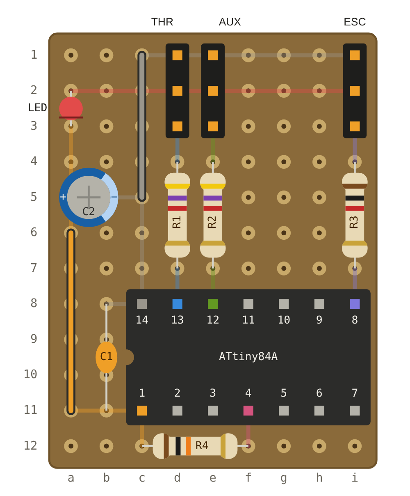
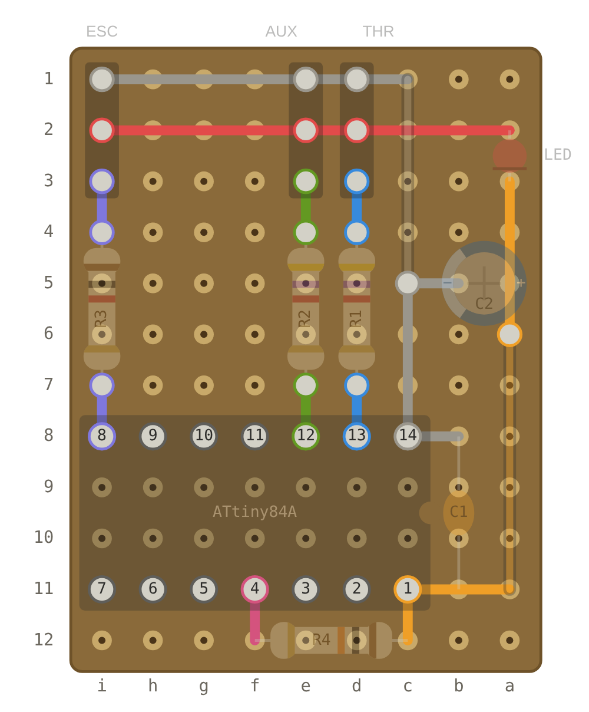

# ATinyCrawl

An inline speed limiter for RC crawlers. A small ATtiny84A board sits between receiver and ESC and scales the throttle with an AUX knob, dial or switch on your radio.

Built for walking with a crawler: hold the trigger against its stop, set the speed with the knob, and a shaky trigger finger no longer turns into a twitchy car.

<p>
  
  
</p>

## Features

- **Scaled, not clipped:** the full trigger travel maps onto the reduced speed range, so fine control gets better at low limits.
- **Works with any radio** that has a free AUX channel. No radio-side mixing or EPA tricks.
- **Knob, switch or button:** a knob gives stepless control, a 2-position switch gives *crawl / full speed*, a 3-position switch gives three steps. Most AUX push buttons toggle between high and low on each press and work like a 2-position switch (a button that only holds while pressed would limit only while you press it).
- **Reverse limited too**, by default half as strongly as forward (adjustable).
- **Power-up order does not matter:** neutral is calibrated from the first stable throttle signal. Until then the ESC gets no pulses, exactly like a receiver without a link.
- **Failsafe:** no throttle signal, no pulses, so the ESC's own failsafe stops the car. Lost AUX signal falls back to a safe limit.
- **No crystal needed:** Timer1 both measures and generates the pulses, so the internal oscillator's tolerance cancels out.

## How it works

```
out = neutral + (throttle − neutral) × limit       (forward)
```

| AUX | Forward | Reverse (default strength 50 %) |
|---|---|---|
| min | 20 % | 60 % |
| max | 100 % | 100 % |

Releasing the trigger always stops the car. ATinyCrawl deliberately has no cruise control: when you stumble or drop the radio while walking, the car must never keep driving on its own.

## Field test

1 hour of walking with a crawler (sensored crawler ESC, 6 V BEC):

- AUX knob at about 1/4 to 1/3 for walking pace (≈ 40–47 % throttle).
- The radio simply hangs on the trigger finger against the stop, no cramped pressing, speed stays constant.
- Full speed across a field with the knob at max: no issues. Walking with the knob at max showed again how restless the trigger finger is without the limiter.

## Hardware

Perfboard, 9 × 12 holes (approx. 23 × 30 mm). Full layout, parts list with colour codes and a printable 1:1 template: [`hardware/ATinyCrawl_Perfboard.pdf`](hardware/ATinyCrawl_Perfboard.pdf).
Interactive layout with net highlighting, test checklist and full docs: [`docs/index.html`](docs/index.html).

| Part | Value | Also ok |
|---|---|---|
| U1 | ATtiny84A-PU in DIP-14 socket | ATtiny84. ATtiny44A/24A should work too (sketch: 1.4 KB flash, 35 B RAM; builds, not tested on hardware) |
| R1, R2 | 4k7 (THR and AUX inputs) | 1 k–10 k, they don't have to match |
| R3 | 1 k (ESC output, protects the pin against a reversed plug) | 330 Ω–2k2 |
| R4 | 10 k reset pull-up | 4k7–47 k |
| C1 | 100 nF ceramic | any ceramic 47 nF–1 µF |
| C2 | 10–100 µF electrolytic, ≥ 6.3 V | 4.7–220 µF, or a 10 µF ceramic/tantalum |
| LED | drops the BEC voltage to ~4 V for the ATtiny and shows power | see the table below |
| J1–J3 | 3-pin headers: THR, AUX, ESC | any 2.54 mm pin header, straight or angled |

The LED sets the supply voltage. Pick it by your BEC voltage:

| BEC | Part instead of / as the LED | ATtiny gets | Also ok |
|---|---|---|---|
| 5 V | 1N4148 diode | ≈ 4.4 V | 1N4001–1N4007 (≈ 4.3 V), 1N5817/1N5819 (≈ 4.7 V), wire bridge (5 V, no power indicator) |
| 6 V | red or yellow LED | ≈ 4.1 V | orange or classic green LED (1.7–2.2 V forward voltage). Not white, blue or bright green |
| 7.4 V | white or blue LED | ≈ 4.4 V, measure to confirm | |

Whatever you use: measure the supply at the chip socket (pin 1 ↔ pin 14) before inserting the chip. 3.0–5.5 V works, 4.0–4.5 V is the sweet spot.

A 3D-printable enclosure (M3 × 16 screw) is in [`hardware/enclosure`](hardware/enclosure).

## Wiring

| Header | Connect to |
|---|---|
| THR | receiver throttle channel |
| AUX | receiver channel with the knob, dial, switch or button (EPA 100/100, no mixing) |
| ESC | ESC signal cable |

All headers: minus at the board edge. Receiver and steering servo are powered through the board's rails, so the BEC current passes through the board.

Set the receiver failsafe for throttle to neutral. If the receiver holds the last value on link loss, ATinyCrawl cannot detect it.

## Firmware

[`firmware/ATinyCrawl/ATinyCrawl.ino`](firmware/ATinyCrawl/ATinyCrawl.ino), about 1.4 KB.

| Setting | Value |
|---|---|
| Core | [ATTinyCore](https://github.com/SpenceKonde/ATTinyCore) |
| Board / chip | ATtiny24/44/84(a) (No bootloader) / ATtiny84(a) |
| Clock | 8 MHz (internal). The sketch refuses to compile otherwise |
| millis()/micros() | Disabled |
| BOD | 2.7 V |

Run *Burn Bootloader* once per new chip to set the fuses, then *Upload Using Programmer*. A matching programmer you can build in ten minutes: [attiny-isp-breadboard](https://github.com/rolandkohn/attiny-isp-breadboard) (Arduino Nano as ISP on a half-size breadboard, no soldering). Program the chip off the board, never with ESC and receiver attached.

Main settings at the top of the sketch:

| Constant | Default | Meaning |
|---|---|---|
| `LIMIT_MIN_PCT` | 20 | forward limit at AUX minimum, also the crawl speed with a switch |
| `LIMIT_REVERSE_STRENGTH` | 50 | how strongly AUX limits reverse, in % of the forward effect |
| `LIMIT_FAILSAFE_PCT` | 30 | limit when the AUX signal is lost |
| `LIMIT_IN_LOW` / `HIGH` | 1050 / 1950 µs | AUX end positions, slightly inside 1000/2000 |
| `FORWARD_IS_HIGH` | true | set to false if the limit acts on reverse |
| `LIMIT_CH_REVERSED` | false | set to true if AUX works the wrong way round |
| `HEARTBEAT` | true | blinks an LED on pin 10 (breadboard). Set false for the chip in the car |

## First run

1. Power off, connect THR, AUX and ESC.
2. Without the chip: go through the test checklist in [`docs/index.html`](docs/index.html) (continuity, shorts, supply voltage below 5.5 V).
3. Power off, insert the chip (notch on the left). Never insert or remove it while powered.
4. Wheels in the air. Radio on, then the car.
5. Check: AUX max behaves like no limiter, AUX min gives 20 % forward and 60 % reverse, both power-up orders are quiet at standstill.

## Licence

- Firmware: [MIT](LICENSE)
- Hardware (layout, PDF, enclosure): [CERN-OHL-P v2](LICENSE-HARDWARE)
